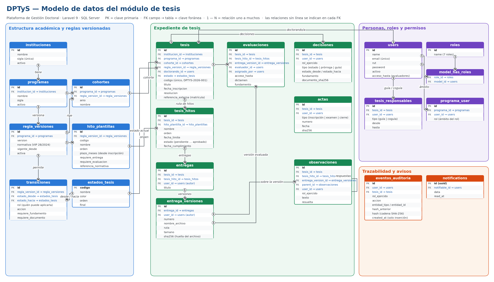

# DPTyS — Plataforma de Gestión Doctoral · Módulo de tesis

Expediente digital de tesis doctoral: hitos con plazos y semáforo, entregas versionadas con huella SHA-256,
observaciones, evaluadores externos con acceso temporal, decisiones con fundamento, actas, bitácora
inalterable (cadena de hash), alertas de plazos, reportes, exportación del expediente (ZIP) y API REST (OpenAPI).

Laravel 9 · PHP 8.2 · SQL Server 2022 · Docker. Basado en la plantilla y la infraestructura de SGQA.

## Modelo de datos



Versión editable: `docs/modelo-datos.mmd` (Mermaid). Para regenerar la imagen: `python docs/generar_modelo_datos.py`.

## Levantar

```bash
docker compose up -d --build
```

Aplicación: http://localhost:8081 · SQL Server: puerto 1434 (no choca con SGQA en 8080/1433).
Las migraciones y los datos de prueba se cargan solos al arrancar.

Cuentas de prueba (ficticias), contraseña `dptys2026`: `direccion@dptys.local` (dirección y guía),
`secretaria@dptys.local`, `guia@dptys.local`, `camila@dptys.local` (doctoranda), `evaluador@externo.local`,
`admin@dptys.local`, `soporte@dptys.local`, `secretaria@udemo.local` (segunda universidad, aislada).

## Comandos

```bash
docker compose exec -u www-data app php artisan dptys:alertas            # avisos de plazos (también diario 08:00)
docker compose exec -u www-data app php artisan dptys:verificar-bitacora # integridad de la bitácora
docker compose exec -u www-data app php artisan dptys:token correo@x.cl  # token para la API
docker compose down -v                                                   # borrar base y archivos
```

Los correos de aviso se escriben en `storage/logs/correos.log` (configurar SMTP en producción).

## Estructura

- `database/migrations` modelo de datos; `database/seeders/ReglasSeeder.php` reglas VIP 28/2024 (plazos **referenciales**, validar con dirección y ESPOS).
- `app/Services` auditoría, motor de estados, expediente, archivos. `app/Support/Permisos.php` reglas de acceso por rol.
- `public/docs/openapi.yaml` especificación de la API (vista en `/api/docs`).
